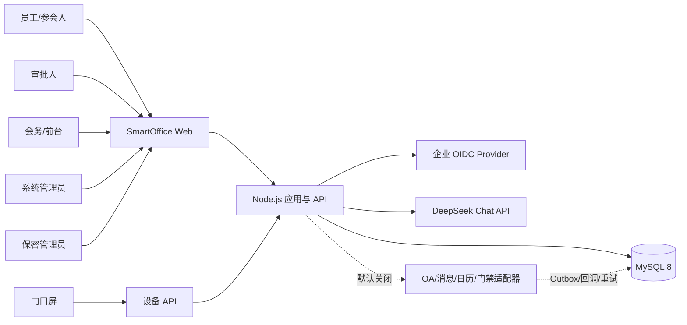
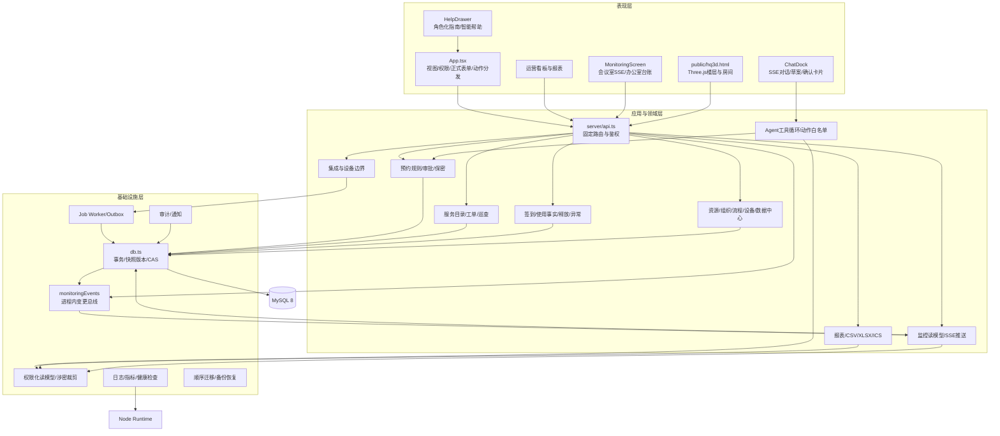
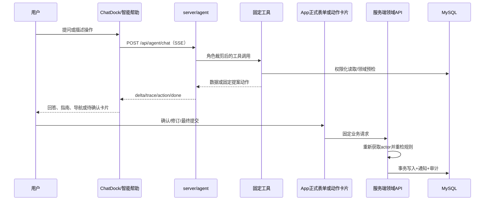

# SmartOffice 系统架构文档

- 文档版本：v1.0
- 基线日期：2026-11-23
- 适用范围：单一企业、MySQL 唯一持久化的智慧办公空间管理系统
- 对应实现：React 19 + TypeScript + Vite 6 + Node.js + MySQL 8 + Three.js 0.160

## 1. 架构目标与边界

SmartOffice 以会议室预约和空间资源管理为核心，覆盖资源查找、正式申请、动态审批、涉密控制、会务工单、签到与实际使用、异常处理、运营报表、总部 3D 空间、可选企业集成和对话式办公助手。

架构遵循以下约束：

1. **单企业部署**：支持多部门、多公司、多楼栋和多角色，不引入 `tenant_id` 或多租户隔离模型；资源与流程界面对外统一使用“公司”，持久字段仍为 `campus/campuses`。
2. **MySQL 唯一持久化**：业务数据、身份、会话、偏好、对话、草案、任务、通知、审计和集成事实均保存在 MySQL；浏览器不保存业务快照。
3. **服务端是最终权威**：前端提示和模型工具预检不能替代服务端身份、权限、状态、冲突和领域规则重检。
4. **高风险操作保留人工确认**：预约新建、修改和续期必须经正式表单提交；审批、取消、签到和工单经操作卡片确认；保密授权、组织同步应用、动态规则集发布、集成补偿/重放、设备撤销/重启和备份恢复不由助手直接执行。
5. **单体模块化**：当前不引入微服务、Kafka、Redis、Kubernetes 或新的 3D 模型框架。
6. **本地证据不等于投产验收**：真实外部平台联调、企业安全测试、正式容量验收、生产迁移恢复、责任方签字、UAT、培训、灰度和稳定观察仍是独立门禁。
7. **审批版本只追加**：系统管理员在“流程配置”维护完整动态规则集本地草稿，经 `baseVersion` 并发校验后发布新版本；服务端重检规则条件、唯一标识/优先级和流程引用并记录审计。新申请使用最新发布版本，在途申请保留提交时冻结的规则与流程，普通预约未命中特殊规则仍自动核准。

## 2. 系统上下文



外部依赖分为三类：

- **必需运行依赖**：MySQL 8；生产认证需要企业 OIDC。
- **智能能力依赖**：DeepSeek `deepseek-chat`。未配置或上游不可用时，基础业务和帮助目录仍可使用，智能对话返回明确错误。
- **可选集成依赖**：企业微信、紧急短信、邮件、OA、企业日历和门禁。适配器默认关闭，目前不能据此声称真实企业平台已联调。

## 3. 总体逻辑架构



### 3.1 表现层

- `App.tsx` 是主应用协调者：加载权限化工作区、维护当前视图、打开正式预约/修改/续期表单、处理助手固定动作、挂载帮助和 ChatDock。
- 根节点 `data-theme` 与 `styles.css` 变量统一承载界面主题；`coamc`“东方蓝”参考中国东方资产官网的白色品牌区、东方蓝导航和深蓝标题，与原五套主题并存。东方蓝品牌区使用同源蓝色横式标志 `public/images/china-orient-logo-horizontal.png`，其他五套主题使用 `public/images/china-orient-logo-horizontal-reverse.png` 透明反白稿并继承当前侧栏主题色；展开时显示完整组合，折叠时仅裁显图形标。桌面侧栏和移动端“更多 → 界面主题”共用同一偏好状态，`server/preferences.ts` 校验主题白名单并通过 `/api/preferences` 保存到 MySQL，刷新、Node 重启和会话复用后恢复。
- `components/OperationsReports.tsx` 与 `components/OperationsDashboard.tsx` 共用一次 `/api/reports` 返回的 `OperationsReport`，分别呈现“管理看板”和“明细与对账”；SVG 图表不引入大型图表库。
- `components/MonitoringScreen.tsx` 通过原生 `EventSource` 接收权限化监控快照，展示会议室实时状态与总部 3D 办公室分配台账；五种会议室状态和四种办公室状态使用独立固定语义色，并保留文字标签，不随主题强调色合并。断连保留最近成功快照并由浏览器自动重连，办公室“已分配”不解释成现场实测有人。
- `components/ChatDock.tsx` 负责流式对话、草案修订、待确认卡片和会话恢复，不直接写业务 API。
- 顶部栏固定帮助入口打开 `components/HelpDrawer.tsx`，提供抽屉式指南、搜索、分类、角色过滤、功能导航和智能帮助入口。
- `helpCatalog.ts` 是帮助与助手共享的功能目录，定义固定系统视图、主题、关键词、步骤和访问边界。
- `public/hq3d.html` 是独立同源 Three.js 页面，通过 `/api/hq3d/snapshot` 获取布局和业务覆盖；主应用以 iframe 嵌入完整页面或空间剖切，并传递白名单 `theme=coamc|classic`。东方蓝在两个入口同步使用同源横式标志、白色面板、蓝色交互态和深海蓝模型背景，原五套主题恢复经典 3D 皮肤；主题仅改变界面外观，不改变房间类别色、空间状态语义或业务数据。`public/hq3d-auditorium.js` 为礼堂/报告厅提供纯几何排座：按房间宽深确定主席台、台前通道、侧向边距、中央过道及行列数，观众席最多 320 座；主席台、讲台、主席桌椅和观众席继续合批到楼层共享 InstancedMesh，不新增逐座 Mesh 或业务容量事实。完整页面按 `capabilities.canManageLayout` 向系统管理员显示原生对话框，支持整栋/单层 JSON、系统 Excel 模板与原生楼层图 Excel 精确更新、单层 PNG/JPEG 本地 OCR 候选、统一预检、差异确认和导入后刷新；原生 Excel 按附件工作表、打印区域、合并单元格、行高和列宽识别，图片漏识别不会停用现有房间，内嵌剖切与员工角色不显示入口。
- 工作区每 10 秒轮询，使用请求防重入和身份隔离，页面隐藏或离线时跳过；自动刷新只读取权限化视图，不触发涉密详情读取审计。
- `ChatDock`、`HelpDrawer`、`OperationsReports` 和 `MonitoringScreen` 通过 `React.lazy` 按需加载；总部 3D 在 `document.hidden` 时取消 RAF，恢复可见后继续。这些优化不改变业务操作流程。

### 3.2 应用与领域层

- `server/api.ts` 只暴露固定 HTTP 路由，所有写操作由明确的服务端处理函数执行。
- `server/bookingService.ts` 和 `utils/bookingRules.ts` 统一预约时间、资源、容量、设备、参会人、冲突、部门日额度和批次校验。
- `server/approvalDomain.ts`、`utils/approval.ts` 与动态规则模块处理冻结流程、节点范围、代理、自审阻断和长期系列审批。
- `server/confidentiality.ts` 负责涉密识别、白名单、访问授权和读模型裁剪。
- `server/serviceDomain.ts`、`server/serviceOperations.ts` 处理服务目录冻结、工单状态机、区域、班次、巡查、成本与 SLA；默认责任区只包含未分配资源，资源、公司和楼栋匹配失败后由 `area-default` 兜底。
- `server/usageDomain.ts`、`server/usageOperations.ts` 处理签到事件、使用确认、实际使用事实、正常完成、提前结束、no-show、使用申诉和释放。
- `server/reports.ts`、`utils/reports.ts` 统一计划/实际使用、部门投入、备料和对账口径；`server/calendarExport.ts` 负责 ICS。
- `server/monitoring.ts` 提供单次权限化快照和 SSE：原始预约只计算当前时间占用，actor 投影生成主题和签到等展示字段；办公室读取总部 3D 当前资料与维护记录形成分配台账，不推断实测在场。首次连接立即发送快照，15 秒心跳、30 秒时间刷新，每次刷新重新认证并串行读取，关闭连接时清理全部任务。
- `server/agent.ts`、`server/tools.ts`、`server/actions.ts` 和 `server/chatConversations.ts` 组成助手闭环。
- `server/hq3d*.ts` 处理 3D 布局、稳定 UID、房间资料、维护、资源映射和受控同步；`server/hq3dLayoutImport.ts` 提供整栋/单层导出、只读预检、baseline 校验、事务导入和审计，`hq3dLayoutExcel.ts` 提供版本化 XLSX 往返及原生附件整栋/单层识别，`hq3dLayoutOcr.ts` 以本地中文 Tesseract 生成单层候选并保留漏识别房间，`hq3dLayoutFiles.ts` 统一分派上传格式。所有正式接口仅向系统管理员开放，OCR 不直接写库。

### 3.3 基础设施层

- `server/db.ts` 提供连接池、读写、事务、快照版本和变更上下文；核心业务写入在数据库事务内完成。
- `server/monitoringEvents.ts` 提供进程内变更订阅；`mutateDb` 只在 `commit` 成功后发布 `workspace`，总部 3D 布局、资料和维护接口在独立写成功后发布 `hq3d`，避免监控推送未提交事实。
- `server/jobStore.ts` 与 `server/jobs.ts` 提供任务租约、过期恢复、指数退避、去重和 Outbox 投递。
- `server/audit.ts` 与通知模块记录关键操作和按用户路由的提醒。
- `server/http.ts`、`server/rateLimit.ts`、`server/observability.ts` 提供请求体限制、安全响应头、认证限流、结构化日志和 Prometheus 指标。
- `server/migrations/` 提供带校验和的顺序迁移；已应用迁移不可改写，结构变化只能新增迁移。
- `scripts/db/native-*.ts` 提供原生备份、覆盖性恢复和隔离恢复演练。

## 4. 运行时与部署架构

### 4.1 开发模式

Vite 提供 React 页面，并通过 `vite.config.ts` 中注册的中间件运行同一套 Node API。默认端口为 3001。开发身份只在非生产、显式开启且请求来自 loopback 时可用。

### 4.2 生产模式

```text
浏览器/门口屏
    │ HTTPS（企业反向代理终止）
    ▼
企业反向代理
    │ 保留原始 Host，受控转发
    ▼
Node.js 单进程（127.0.0.1:3001）
    ├── API、认证、领域服务
    ├── dist 静态文件与 hq3d.html
    ├── Job Worker + Outbox Worker
    └── mysql2 连接池（默认 10）
              │
              ▼
           MySQL 8
```

Node 启动时启动 Job Worker，收到 SIGINT/SIGTERM 后停止接收连接、等待 worker 收尾并关闭连接池。`/livez` 只表示进程存活，`/healthz` 检查数据库 readiness，`/metrics` 提供受控指标读取。

生产部署要求：

- `NODE_ENV=production`，关闭开发身份；OIDC issuer 和回调使用 HTTPS。
- 反向代理限制管理面与数据库网络访问，MySQL 不对公网或普通办公终端开放；监控 SSE 需同源转发并禁用响应缓冲。
- 监控变更总线仅存在于当前 Node 进程，不跨实例传播；当前候选按单进程部署，扩展多实例前必须另设经过验证的跨实例发布机制，不能直接声称已支持多实例实时同步。
- 仅当代理会覆盖外部传入的 `X-Forwarded-For` 时启用 `SMART_OFFICE_TRUST_PROXY`。
-  secrets 仅通过受控环境注入，不进入前端 bundle、文档、聊天、日志或报告。
- 应用回滚与数据库回滚分开处理；数据库没有自动 down migration，不能让旧应用直接承接不兼容新库写入。
- Tailwind CSS 经 PostCSS 在构建期生成，字体从同源 `/vendor/fonts/` 加载；生产 CSP 以 `default-src 'self'` 为基础，不依赖 Tailwind CDN 或 Google Fonts 运行时资源，也不为其增加外部放行。

## 5. 数据架构

### 5.1 持久化原则

MySQL 是唯一事实来源。当前数据面由两类结构组成：

1. **核心办公聚合与投影**：`office_state` 保存带版本的核心聚合 JSON；`bookings`、`notifications` 等表支撑关键查询和写入。领域事务同时维护聚合、投影、任务、Outbox 和审计，不能只更新其中一处。普通 mutation 比较前后内容，仅写变化集合、预约和通知；`replaceBookings` 仍按设计全量替换预约投影。
2. **独立关系表**：身份、OIDC 请求、会话、用户偏好、ChatDock 会话、定时任务、Outbox、审计、总部 3D 布局/资料/维护、资源映射/处置/退役归档等使用专门表。通知列表直接查询 `notifications` 关系表；定向通知沿用通知行已读字段，`sys` 广播通过 `notification_read_states(notification_id,user_id)` 独立保存每个用户的已读事实，读取互不影响。已读更新保留 `smart_office_write` 锁和事务并幂等写入，但不推进核心 revision、不重复写 Outbox。迁移 `017_notification_read_path.sql` 增加通知读取索引，`017z_notification_read_states_collation.sql` 先按既有 `notifications.id` 排序规则兼容建表，`018_notification_read_states.sql` 再幂等确认按用户广播已读表，兼容升级库与新初始化库且不改写通知数据。

主要数据分组：

| 数据分组 | 核心内容 | 关键一致性约束 |
|---|---|---|
| 组织与权限 | 用户、部门、角色、身份绑定、审批代理 | 外部身份只绑定已有用户；角色与节点范围共同授权 |
| 空间资源 | 资源、容量、设备、楼栋楼层、开放状态、专属属性 | 维护/缩容/删除前检查有效预约与设备依赖 |
| 预约与审批 | 预约、系列、冻结流程、审批历史、规则快照 | 状态、排期版本、冲突、额度和审批在同一事务重检 |
| 会务与使用 | 服务目录快照、工单、巡查、签到事件、使用事实、申诉 | 目录版本冻结；事件与排期版本关联；释放联动服务和授权 |
| 总部 3D | 楼栋、楼层、稳定房间 UID、资料、维护、映射、处置 | `resourceId—roomUid` 显式一对一，不按名称猜测 |
| 实时监控 | 核心预约/资源与总部 3D 的按需只读投影 | 不新增持久表；时间占用与 actor 展示字段分离；进程内事件只触发重读，不承载业务事实 |
| 助手与帮助 | 会话 turns、handled、input、固定动作和草案 | 用户隔离、字段白名单、revision 乐观锁、确认后重检 |
| 任务与集成 | scheduled_jobs、Outbox、投递、回调、授权事实 | 确定性 key、租约、重试、死信、幂等和审计 |
| 运维证据 | 审计事件、迁移记录、备份和恢复事实 | 关键写入留审计；备份校验和；恢复需明确确认 |

### 5.2 时间与版本

- 时间戳以 ISO/UTC  Instant 保存和传输，界面按本地时区展示；自然日、开放时段、长期截止日按本地日历规则计算。
- 预约带 `scheduleVersion`，改期后旧提醒、no-show、工单和集成事件不能误作用于新排期。
- 预约提交时冻结审批流程、规则版本、申请部门、资源公司和服务目录快照，后续配置变化不悄然改写历史申请。
- ChatDock 会话使用独立 `revision`，防止旧窗口覆盖新对话。
- 核心快照有版本控制，并发写入发生冲突时返回错误，而不是最后写入者无声覆盖。

### 5.3 错误协议与用户提示

- 服务端继续返回稳定业务错误码和适当 HTTP 状态，原始码保留在 API、结构化日志、审计和技术联调中。
- 前端统一把业务失败转换为中文原因或处理建议；已知错误码使用公共或页面专用中文映射，可用中文说明予以保留，未知错误码、数字状态码和英文网络错误不直接展示。
- 主请求在内部错误对象保留原始 `code`，不破坏代理审批等页面的专用映射；显示文案与接口契约分离，不把网络失败或旧数据当成业务成功。

## 6. 安全架构

### 6.1 认证与会话

- 生产使用 OIDC Authorization Code Flow + PKCE S256。
- 外部身份通过 `issuer + subject` 绑定既有内部用户，不按邮箱自动绑定或自动创建未知用户。
- 浏览器 Cookie 仅保存不透明随机会话令牌，MySQL 保存 SHA-256 哈希；生产 Cookie 使用 `__Host-` 前缀。
- 登录、OIDC 回调和开发认证按客户端 IP 与路由限流。

### 6.2 授权与数据裁剪

- 导航可见性不是安全边界；API 每次从当前会话重新获取 actor。
- `getActorDbView` 对无权限预约做字段级脱敏；涉密不可见模型清空申请人、参会人及人员冲突投影 ID，普通预约保留去重的人员投影用于冲突提示。
- 监控快照和每次 SSE 刷新均按当前 actor 重新裁剪。原始预约只用于计算是否仍占用，主题、签到时间和签到状态只能来自权限化投影，防止脱敏后的提前结束/释放字段缺失造成误报，也防止从原始记录恢复涉密信息；自动刷新不记 `CONFIDENTIAL_READ`。
- 普通预约详情仅向申请人、参会人、授权审批人、相关会务角色和管理员开放。
- 涉密预约还要求访问授权、申请人/参会人身份、保密角色或可审批范围；系统管理员身份不自动获得涉密读取或直接写操作权限，通知和报表中的涉密用途统一隐藏。
- 涉密工单和巡查按具体负责角色开放最小履约范围，不授予完整涉密预约读取权；履约视图继续隐藏主题、申请人、参会人、联系人和其他非必需字段，申请人补录及无关会务角色仍受原专用授权约束。
- 工作区轮询不记录 `CONFIDENTIAL_READ`；用户主动展开详情通过 `POST /api/bookings/:id/confidential-read` 重检同一专用读取授权，并记录 `source=BOOKING_DETAIL` 审计。
- 助手工具集按角色、审批节点和实际工单职责裁剪，模型不能通过提示词获得额外工具。

### 6.3 Web 与设备安全

- 默认 CSP、禁止嵌入、`nosniff`、同源 opener/resource policy；生产增加 HSTS。
- 仅总部 3D 及其 Three.js 静态依赖使用允许同源 iframe 和行内脚本的专门安全档。
- JSON 请求体默认最大 1 MB；总部 3D 统一文件解析使用独立 12 MiB 上限，并在解码后分别限制 JSON、Excel、图片为 2、4、8 MiB。Node 同时限制请求头、请求耗时和连接复用。
- CSV/XLSX 对公式前缀做电子表格注入防护。
- 门口屏使用独立设备接口和令牌边界；设备令牌不得进入对话、文档、日志、备份说明或测试报告。

## 7. 助手与帮助架构

### 7.1 共享功能目录

`helpCatalog.ts` 同时服务于：

- 帮助抽屉的主题、搜索、分类和“打开功能”；
- 助手 `search_help` 的角色化检索与 `OPEN_HELP`；
- 助手 `navigate_system` 的固定视图枚举；
- 前后端对当前角色可见指南的再次校验。

新增功能时必须同步该目录，避免用户手册、抽屉和助手口径分裂。

### 7.2 工具调用与动作闭环



- 最多 6 轮工具循环、20 条历史消息、单条输入 4000 字符；SSE 每 15 秒发送心跳。
- DeepSeek 请求默认采用有界 60 秒超时（可由配置调整），组合内部 `AbortController`、外部取消信号和定时器；流式读取在中止时取消 reader，客户端 `aborted`/`close` 会向上游传播取消。
- 工具只返回白名单动作，模型不能指定 URL、HTTP 方法或任意请求体。
- `PROPOSE_BOOKING`、`PROPOSE_EDIT_BOOKING`、`PROPOSE_RENEW_BOOKING` 仅打开正式表单。
- `PROPOSE_CANCEL`、`PROPOSE_APPROVAL`、`PROPOSE_CHECK_IN`、`PROPOSE_WORK_ORDER` 由 `/api/agent/action` 再次鉴权并在事务中执行。
- `OPEN_HELP`、`NAVIGATE`、`REFRESH` 由前端固定分发；无任意脚本或视图名执行。
- `query_hq3d_spaces` 是总部 3D 只读数据面，实际调用时才动态加载 `getHq3dSnapshot()`，不会在无关对话中预加载全量布局。查询复用登录用户可读的 MySQL 快照，应用房间资料覆盖值，并限制房间结果和维护摘要数量；不读取涉密会议主题或预约详情。
- `NAVIGATE.hq3d` 仅允许 `buildingId`、可选正整数 `floorNo` 和可选 `roomUid`。App 通过 `URLSearchParams` 构造同源 iframe 地址，完整总部 3D 页面负责定位；唯一房间关键词命中才选中房间，明确楼栋或楼层查询只定位相应范围，`embed=spatial` 剖切不应用定位。资源映射和候选可订状态不等于已建档或当前可预约。
- 会话 sanitizer 只保留允许的字段，包括服务目录快照和上述总部 3D 固定定位字段，不持久化任意 URL 或对象；刷新或服务重启只恢复对话、草案和定位卡片，不自动提交或执行动作。

### 7.3 能力分层

| 层级 | 能力 | 示例 |
|---|---|---|
| 直接读取 | 当前权限内查询 | 空档、我的预约、待办、待审批、工单、总部3D空间、简化使用统计 |
| 导航与指导 | 固定视图、3D目标和帮助主题 | 打开运营报表、定位3D房间、说明导出、查看保密控制指南 |
| 表单草案 | 只预填，不落库 | 新建、修改、长期续期 |
| 确认后执行 | 卡片确认 + 服务端重检 | 取消、审批、签到、完成工单 |
| 仅人工高影响操作 | 助手不执行 | 白名单/授权、组织同步应用、集成补偿/重放、设备撤销/重启、备份恢复 |

`get_usage_stats` 是面向对话的简化聚合，不等同于正式 `/api/reports` 的完整对账模型；需要管理报表时助手应导航到运营报表。

## 8. 关键业务架构

### 8.1 预约到使用闭环

```text
资源/3D/助手查空档
  → 正式表单（或助手草案预填）
  → 联系人与预约属性校验
  → 资源/时间/容量/设备/冲突/参会人/部门额度校验
  → 冻结规则、流程和服务快照
  → 审批（普通/重要/涉密/专属/重服务/长期）
  → 核准与会务工单/巡查/提醒
  → 签到与实际使用事实
  → 完成、提前结束、取消或 no-show 释放
  → 报表对账、通知、审计和可选集成事件
```

签到和使用确认的窗口均为 `startTime - 15min <= now < endTime`；确认 `UNUSED` 必须填写说明并复用取消授权。签到、使用确认、人工释放、申诉和提前结束等涉密直接写路径复用涉密专用读取授权，系统管理员身份不能绕过；具体工单和巡查仅按责任范围开放最小履约权限，不因此开放完整涉密预约。

已签到且仍为 `APPROVED` 的预约在计划结束时间由 `BOOKING_COMPLETION` 正常结算为 `COMPLETED`，`actualEndTime` 等于计划 `endTime`；该路径与 no-show、确认未使用和提前结束分离。提前结束按实际操作时间核算额度，正常完成按计划时段核算。

取消和释放需要联动剩余时段、部门额度、未完成服务和门禁授权；旧排期版本的异步任务必须失效。

使用申诉只接受 `NO_SHOW`、`MANUAL_EXCEPTION`、`UNUSED_CONFIRMED` 三类释放，主动取消不可申诉。恢复前重检冲突、额度、资源和涉密白名单；原冻结审批流程为空才直接恢复核准并重建工单与使用任务，流程非空则恢复待审批、清空旧审批历史并从首节点重审，核准前只创建审批任务。

### 8.2 总部 3D 与资源库

- 3D 布局以稳定 UID 标识房间；布局初始化可重复执行，移除项差异停用而不删除历史资料。
- 管理员可导出当前布局 JSON 或系统 Excel 模板，按整栋/单层精确更新；也可直接上传附件结构的原生楼层图 Excel，或上传单层 PNG/JPEG 由本地 Tesseract 中文 OCR 生成同一标准布局候选。统一 `POST /api/hq3d/layout/parse` 只解析不写库，所有格式再进入相同预检和明确确认流程。
- 系统 Excel 使用“布局信息、楼层、房间、填写说明”版本化工作簿并保留空楼层。原生 Excel 按楼栋与中文楼层工作表识别，二层优先“全”、十四层优先“新”，按打印区域、合并单元格、行高和列宽还原几何，并按房号、名称和位置沿用稳定 UID；封皮、未选版本和打印区域外杂值不进入布局，仅支持附件所示结构，不宣称兼容任意 Excel。
- 图片校验真实文件头、大小和像素，OCR 串行执行、语言包自托管并采用自适应阈值改善高亮背景识别。房号匹配房间的部门、人员等多行文字变化进入候选和预检，同时保留原 UID、类别、维护备注和几何；纯格式差异不制造更新，未识别现有房间全部保留，新房间只按文字位置估算坐标，识别误字和坐标均需人工核对。
- `server/hq3dLayoutImport.ts` 复用同一稳定 UID 和归一化几何，首版只更新既有楼层；局部导入不影响范围外楼栋或楼层，整栋文件必须包含当前全部楼层。预检返回新增、修改、恢复、停用、不变及 baseline hash；正式导入在事务锁内重算并拒绝过期预检。
- JSON、系统 Excel 模板和原生楼层图 Excel 省略的未映射房间只软停用，已映射房间省略会被拒绝；这与图片漏识别自动保留的语义明确分离。资料、维护、映射和历史保留，新房间不自动成为可预约资源。成功导入写一条 `HQ3D_LAYOUT_IMPORT` 审计；助手仅提供角色化帮助和导航，不直接上传、识别或执行布局维护。
- 资源库与 3D 通过显式 `resourceId—roomUid` 映射共享业务状态，未映射空间不按名称自动关联。
- 主应用提供筛选、房间名录、预约和管理；同源 `postMessage` 只同步约定消息和楼栋楼层状态，并检查 origin/source。
- 当前基线有 14 条已确认映射；未核定 UID、PENDING 资源、候选空间和双人复核仍按 UAT/责任方门禁处理。

### 8.3 报表

正式报表由服务端按 actor 权限生成同一 `OperationsReport`：

- 管理看板：核心指标、计划/实际趋势、空间使用、部门投入、会务状态、管理关注事项。
- 明细与对账：预约、签到、实际使用、服务成本、备料和差异原因。
- 导出：CSV 和 XLSX 与当前筛选使用同一数据快照；请求必须携带页面 `report.revision`，缺失返回 400，快照变化返回 409，前端刷新后要求重新导出。
- 跨范围时长裁剪到统计范围及每日开放区间；报表区分未到使用结算、待结算、正常完成、提前结束、no-show、取消、待确认实际使用和事实异常，不把正常结算与提前结束或 no-show 混算。

## 9. 异步任务与集成架构

Job Worker 与 Node 同进程运行，浏览器关闭后仍可执行：

1. `reconcileJobs` 根据当前预约和规则补齐提醒、审批升级/关闭、`BOOKING_COMPLETION`、no-show、服务 SLA 和巡查任务；正常完成 key 包含预约 ID 与 `scheduleVersion`。
2. `FOR UPDATE SKIP LOCKED` 领取任务或 Outbox，设置 worker 租约。
3. 执行前重查当前业务状态、提交批次、审批节点和 `scheduleVersion`。
4. 成功标记 DONE；失败按次数指数退避，超过上限进入 FAILED。
5. 通知使用确定性 ID 去重，外部事件使用确定性 event key 和投递事实支持对账。

`BOOKING_COMPLETION` 只处理已到计划结束、仍为 `APPROVED` 且已签到的预约，在事务中重检状态，并通过确定性通知 ID 和任务版本保证重试幂等；旧排期版本安全失效。

外部集成采用 Outbox，不在核心预约事务中直接依赖远端可用性。补偿、重放和 OA 回调有专门权限与幂等边界；默认关闭的适配器不影响本地核心流程。

## 10. 可观测性、备份与恢复

- 日志为 JSON 结构，使用 request ID 关联，不记录 query、Cookie、Token、密码或 OIDC code。
- 重点指标：数据库可用性、HTTP 状态/延迟、认证失败与限流、API 失败、Job tick 失败。
- 告警应至少覆盖 readiness 连续失败、5xx 增长、认证/任务异常激增，并路由到真实值班人。
- 原生备份使用 `mysqldump --single-transaction`，生成 SHA-256 校验文件；凭据写入临时 0600 配置文件。
- native restore 在启动 `mysql` 前强制校验非空 SQL、同名 `.sha256` 侧车、侧车内原始文件名和实际 SHA-256；`SMART_OFFICE_RESTORE_CONFIRM` 必须与目标 `DATABASE_NAME` 完全一致。
- 恢复是覆盖性操作，必须停止写入、确认目标库、校验备份并获得数据库负责人批准。
- 隔离演练只允许 `smart_office_test_` 前缀，验证核心表行数和迁移要求，仅清理自己创建的临时库。
- 企业需另行确认 RPO/RTO、加密、异地副本、保留期和恢复责任人。

## 11. 测试与发布门禁

| 层级 | 真实范围 | 不能替代的事项 |
|---|---|---|
| TypeScript | 全项目静态类型 | 浏览器交互和真实权限组合 |
| Node 单测 | 领域规则、工具、报表、3D、任务，以及监控占用/脱敏/办公室台账和事件清理 | MySQL 事务和并发 |
| 隔离集成测试 | 真实 Node + 隔离 MySQL + Fake OIDC/端点，以及监控 SSE 初始推送、写后推送和断连清理 | 真实企业平台联调 |
| Chrome E2E | 真实 UI、移动导航、表单、审批、助手/帮助恢复，以及监控筛选、375px 布局和 SSE 即时更新 | 真机、真实 IME、读屏、企业浏览器、低端设备能耗和全企业容量 |
| 容量工具 | 原始延迟、吞吐、错误率、资源曲线和指标快照 | 未确认模型下的正式 P9-03 |
| 恢复演练 | 隔离库备份恢复、迁移和对账 | 生产恢复签字 |
| wb/CI | 类型、单测、构建、迁移、集成、E2E、恢复 | 企业安全、UAT、灰度和稳定观察 |

集成和浏览器写测试必须显式设置 `SMART_OFFICE_TEST_MYSQL=true`，并使用 `smart_office_test_` 前缀数据库；不得指向真实业务库。

发布采用“先备份、再迁移、后应用”，先灰度再扩量。出现数据库 readiness 持续失败、核心写入错误、审批越权或数据不一致时立即停止扩量并保留请求 ID、审计和指标。

## 12. 当前限制与后续门禁

1. 可选外部集成只完成隔离 Fake 端点验证，真实 OA、消息、日历、门禁和门口屏现场联调仍需企业证据。
2. 正式 P9-03 容量验收必须基于已确认员工、会议室、门口屏、门禁和并发/响应阈值；探索性结果不得外推。
3. 企业安全测试、生产迁移与恢复演练、发布候选评审和责任方签字不能由本地测试代替。
4. 资源与 3D 的未确认映射、PENDING 容量和候选空间需管理员在 UAT 中维护或确认。
5. 旧应用对新 schema 的直接写入不具备完整兼容性；无损回滚路径是停止写入并恢复兼容备份，而非直接切换旧代码继续写入。
6. 智能助手依赖外部模型可用性，但模型不可用不影响正式页面、静态帮助和核心业务。
7. 真机、真实中文 IME、读屏、企业浏览器和低端设备能耗仍需外部验收，本地 Chrome 或模拟移动视口不能替代。

## 13. 文档与实现同步约定

每次功能更新必须同时检查并更新：

- `docs/SYSTEM_ARCHITECTURE.md`：模块、数据流、安全或部署边界变化；
- `docs/DETAILED_DESIGN.md`：领域规则、API、状态机、工具动作和持久化变化；
- `docs/USER_MANUAL.md`：用户可见入口、步骤、角色和注意事项；
- `helpCatalog.ts`：功能指南、搜索关键词和角色化导航；
- `components/HelpDrawer.tsx`：帮助交互；
- `server/agent.ts`、`server/tools.ts`、`components/ChatDock.tsx`：助手工具、提示词、动作和确认边界；
- 对应单元、集成和 Chrome 回归。

若某能力尚未实现或仍需外部验收，文档和帮助必须明确写为限制，不能把规划描述成已上线能力。
